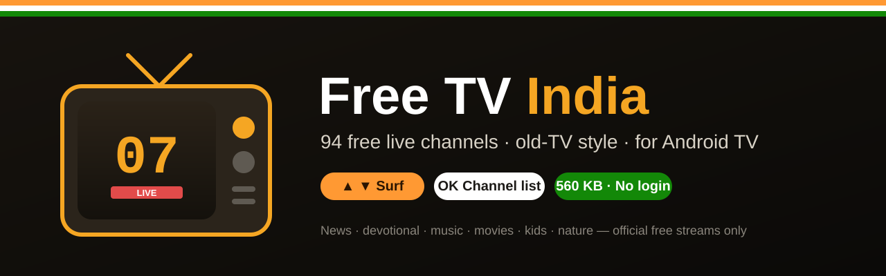
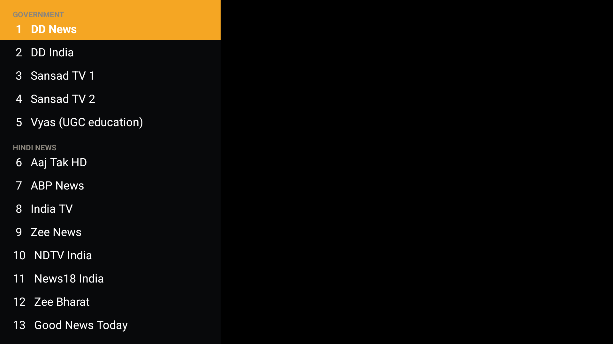
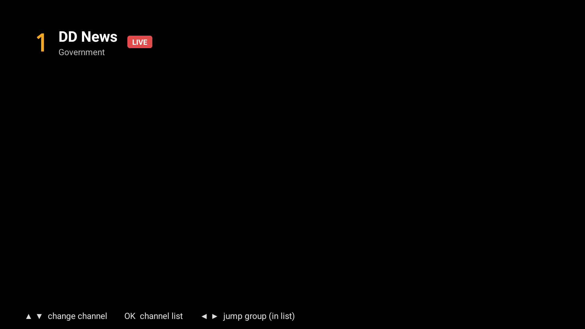
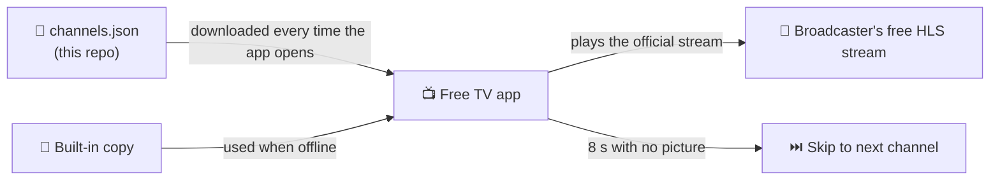

<div align="center">



# Free TV India 📺

**A free, legal IPTV player that turns any Android TV, Google TV, Fire TV or projector into an old-school television.**<br>
Press **▲ ▼** to flip through **94 free live Indian & international channels**: no login, no subscription, no ads in the app, no clutter.

[](https://github.com/znxare/free-tv-channels/releases/latest/download/FreeTV.apk)
[](docs/CHANNELS.md)
[](#-why-its-so-light)
[](#-install)
[](LICENSE)

[**⬇️ Download**](#-install) · [**📺 Channel list**](docs/CHANNELS.md) · [**🎮 Remote controls**](#-remote-controls) · [**⚙️ How it works**](#%EF%B8%8F-how-it-works) · [**➕ Suggest a channel**](../../issues/new/choose)

</div>

---

## ✨ Why Free TV India?

Most "free TV" apps are heavy, full of pop-ups, or quietly stream pirated channels. **Free TV India is the opposite.**

| | |
|---|---|
| 🇮🇳 **Made for India** | Aaj Tak, ABP, Zee News, India TV, NDTV, News18, DD News, Sansad TV, Aastha, 9XM, Shemaroo, Dangal, Zee Cinema classics and more, plus the best free international channels. |
| ✅ **100% official streams** | Every channel is the broadcaster's **own free stream** or an official free-TV partner feed (like Samsung TV Plus or Rakuten TV). No piracy, no shady servers. |
| 🪶 **Featherweight** | **~560 KB** APK and around **40 MB of memory** while playing. Runs smoothly on budget projectors and old TV boxes. |
| 📡 **Feels like real TV** | Opens on your last channel. ▲ ▼ to surf, a channel number pops up in the corner, dead channels are skipped automatically. |
| 🔄 **Self-updating channel list** | The app downloads the latest list from this repo every time it opens, so new channels appear without reinstalling. |
| 🔒 **Private by design** | No account, no tracking, no analytics, no ads in the app. It only talks to this repo and the channels themselves. |

## 📸 Screenshots

<div align="center">


<br><sub>Left: press <b>OK</b> for the channel list. Right: the banner that pops up every time you change channel.</sub>
</div>

## 📺 What's on

**94 channels in 11 groups.** See the [full channel list →](docs/CHANNELS.md)

| | Group | Highlights |
|---|---|---|
| 🏛️ | **Government** | DD News, DD India, Sansad TV 1 & 2, Vyas (UGC education) |
| 🗞️ | **Hindi news** | Aaj Tak HD, ABP News, India TV, Zee News, NDTV India, News18 India, Times Now Navbharat, News Nation |
| 📰 | **English news** | NDTV 24x7, India Today, WION, Republic TV, CNN-News18, Times Now |
| 📈 | **Business** | CNBC-TV18, CNBC Awaaz, ET Now, NDTV Profit, BT TV |
| 🌍 | **World news** | Al Jazeera, DW, France 24, Reuters, NBC News NOW |
| 🪔 | **Devotional** | Aastha, Aastha Bhajan, Vedic, Channel Divya, Hare Krsna TV |
| 🎵 | **Music** | 9XM, 9X Jalwa, B4U Music, Zoom, YRF Music, Shemaroo Filmi Gaane |
| 🎬 | **Movies** | Zee Cine Classic, Zee Dil Se, Zee South Flix, Shemaroo Bollywood, Kadak |
| 🎭 | **Entertainment** | Shemaroo TV, Dangal, Aap Ki Adalat, Mr Bean, Red Bull TV, Tastemade |
| 🦁 | **Knowledge** | History TV18, BBC Earth, Travelxp, Love Nature, WildEarth, MagellanTV |
| 🧸 | **Kids** | Moonbug Kids, Mr Bean Animated, Ryan and Friends, Epic Kids, The Jungle Book |

## ⬇️ Install

> **Works on:** Android TV, Google TV, Fire TV, Android projectors (Lumio, Wanbo, XGIMI…), Android TV boxes and Android phones. Android 5.0 or newer.

### Option 1: with the free *Downloader* app (easiest, no computer needed)

1. On your TV, install **Downloader** (by AFTVnews) from the Play Store.
2. Allow it to install apps: **Settings → Apps → Security & restrictions → Unknown sources → Downloader → On**.
3. Open Downloader and enter this address:
   ```
   https://github.com/znxare/free-tv-channels/releases/latest/download/FreeTV.apk
   ```
4. Press **Install**, then **Open**. Free TV appears on your home screen with its own banner.

### Option 2: from a computer, with ADB

```bash
adb connect <your-tv-ip>:5555
adb install FreeTV.apk
```

### Option 3: USB stick

Copy [`FreeTV.apk`](https://github.com/znxare/free-tv-channels/releases/latest/download/FreeTV.apk) to a pen drive, plug it into the TV and open it with any file manager.

## 🎮 Remote controls

Designed for the simplest remotes: **no number keys needed.**

| Button | While watching | In the channel list |
|---|---|---|
| **▲ Up** | Next channel | Move up |
| **▼ Down** | Previous channel | Move down |
| **OK** | Open the channel list | Play the highlighted channel |
| **Hold OK** | ★ Add or remove favourite | ★ Add or remove favourite |
| **◀ ▶** | Show what's playing | Jump to the previous or next group |
| **Hold ▶** | Turn *start when the TV turns on* on or off | |
| **Back** | Exit the app | Close the list |

⭐ **Favourites** appear in their own group at the top of the list.

## ⚙️ How it works



1. **One small file runs everything.** [`channels.json`](channels.json) lists every channel's number, name, group and official stream address.
2. **The app checks for a new list on every launch.** If there is one, it switches over without interrupting what you're watching and shows *"Channel list updated"*. If you're offline, it uses its last saved copy, or the copy built into the APK.
3. **Streams play directly** with Android's own [Media3 ExoPlayer](https://developer.android.com/media/media3/exoplayer), so there's no browser, no YouTube and no middleman.
4. **Dead channels skip themselves.** If a channel shows no picture for 8 seconds, the app moves on in the direction you were surfing, just like flipping past a blank channel on an old TV.

### 🪶 Why it's so light

| | Free TV India | Typical IPTV app |
|---|---|---|
| APK size | **~560 KB** | 20–60 MB |
| Memory while playing | **~40 MB** | 150–400 MB |
| Web browser inside | ❌ No | ✅ Usually |
| Ads and trackers | ❌ None | ✅ Usually |
| Account needed | ❌ No | Often |

The whole interface is drawn in code (no layout files, no image assets), R8 strips everything unused, and the player uses small live-TV buffers.

## 🛠️ Build from source

You need **JDK 17** and the **Android SDK** (platform 34, build-tools 34).

```bash
git clone https://github.com/znxare/free-tv-channels.git
cd free-tv-channels/app
echo "sdk.dir=/path/to/Android/sdk" > local.properties
gradle assembleRelease          # Gradle 8.7
# → app/build/outputs/apk/release/app-release.apk
```

| Path | What's inside |
|---|---|
| [`channels.json`](channels.json) | The live channel list the app downloads |
| [`app/`](app) | Android TV app source (Java, Media3 ExoPlayer) |
| [`app/app/src/main/java/tv/free/oldtv/MainActivity.java`](app/app/src/main/java/tv/free/oldtv/MainActivity.java) | Player, remote handling, channel list, favourites |
| [`docs/CHANNELS.md`](docs/CHANNELS.md) | Human-readable channel list |

## ➕ Add or fix a channel

Channels change their stream addresses from time to time. Help keep the list fresh:

- 🔴 **A channel stopped working?** → [Report a broken channel](../../issues/new?template=broken-channel.yml)
- 🟢 **Know an official free stream?** → [Suggest a channel](../../issues/new?template=new-channel.yml)
- 🧑‍💻 **Want to send a fix?** → Read [CONTRIBUTING.md](CONTRIBUTING.md) and edit [`channels.json`](channels.json).

Every TV running the app picks up merged changes the next time it opens. **We only accept official, free-to-air streams.** Paid channels and re-streams are always rejected.

## ❓ FAQ

<details>
<summary><b>Is this legal?</b></summary>

Yes. Free TV India doesn't host or re-stream any video. It is a player that opens the **free, public streams that broadcasters and free-TV services publish themselves**. Paid channels (Star, Sony, Colors, Discovery, Cartoon Network and so on) are deliberately **not** included.
</details>

<details>
<summary><b>Why isn't channel X included?</b></summary>

Either it's a paid channel, or we couldn't find an official free stream for it. If you know of one, [suggest it](../../issues/new?template=new-channel.yml).
</details>

<details>
<summary><b>A channel shows "off-air, skipping".</b></summary>

Some channels only broadcast at certain hours, and stream addresses sometimes change. The app skips them automatically. [Report it](../../issues/new?template=broken-channel.yml) if it lasts more than a day.
</details>

<details>
<summary><b>Does it work outside India?</b></summary>

Most channels do. A few Indian broadcasters limit their free stream to viewers in India.
</details>

<details>
<summary><b>Does it collect any data?</b></summary>

No. There is no login, no analytics and no ads in the app. It remembers your last channel and favourites on the TV itself, and nowhere else.
</details>

## ⚖️ Disclaimer

Free TV India is an independent, non-commercial project. It does not host, store, record or re-transmit any content. All channel names, logos and content belong to their respective owners, and each stream is provided by its broadcaster or official distribution partner. If you are a rights holder and want a stream removed from the list, please [open an issue](../../issues/new/choose) and it will be removed promptly.

## 🔎 Also known as

Free TV India is a **free IPTV app for India**: an **IPTV player for Android TV**, a **live TV app for Google TV and Fire TV Stick**, and a lightweight **M3U8 / HLS player** for **Android projectors and TV boxes**. People find it when searching for:

`free IPTV India` · `Indian IPTV player` · `IPTV for Android TV` · `free live TV app` · `Hindi live TV` · `Hindi news live` · `Indian TV channels free` · `desi TV app` · `Bollywood TV channels` · `M3U8 player for TV` · `IPTV for projector` · `free TV for Fire Stick` · `DD News live` · `Aaj Tak live TV` · `Aastha live` · `kids cartoon channels free`

> Unlike most IPTV apps and M3U playlists, every channel here is an **official free stream**. There are no paid channels and no pirated re-streams, so it's safe to use and share.

## 🙏 Credits

- [Android Media3 ExoPlayer](https://github.com/androidx/media), the playback engine
- [iptv-org](https://github.com/iptv-org/iptv), a community index that helped find official free streams
- Every broadcaster that keeps a free stream on the air ❤️

<div align="center">

---

**Made with ❤️ in India** · If Free TV India brings back that old-TV feeling, give it a ⭐ so more people can find it!

<sub>🟧 ⬜ 🟩</sub>

</div>
